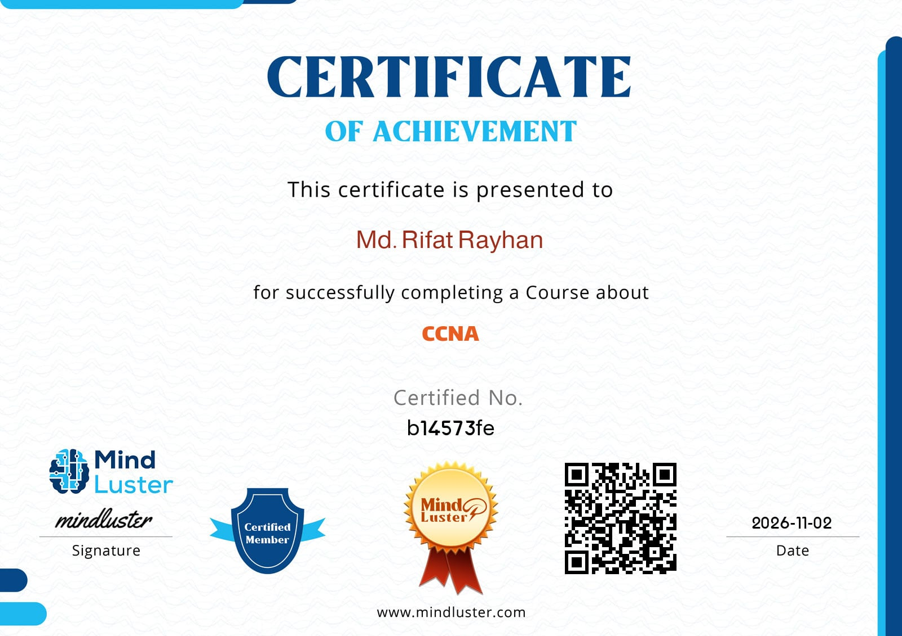

👋 Hi, I’m Rifat Rayhan

CSE Student at "Bangladesh University of Business & Technology"

👨‍💻 About Me

I’m interested in Computer Networking, Systems, and Infrastructure. Currently building strong fundamentals in networking and preparing for CCNA.

🎯 Career Goal

Aspiring Network Engineer focused on Cisco Networking, TCP/IP, VLANs, Routing & Switching.

📚 Currently Learning

CCNA (Cisco Certified Network Associate), 
Cisco Networking Fundamentals, 
TCP/IP Protocol Suite, 
VLANs & Subnetting, 
Routing & Switching Basics

🏆 Certifications & Badges

🤝 Collaboration

Open to collaborating on networking labs, simulation projects, and IT infrastructure learning.

📊 GitHub Stats

📫 Contact

Email: rifatrayhan012@gmail.com
