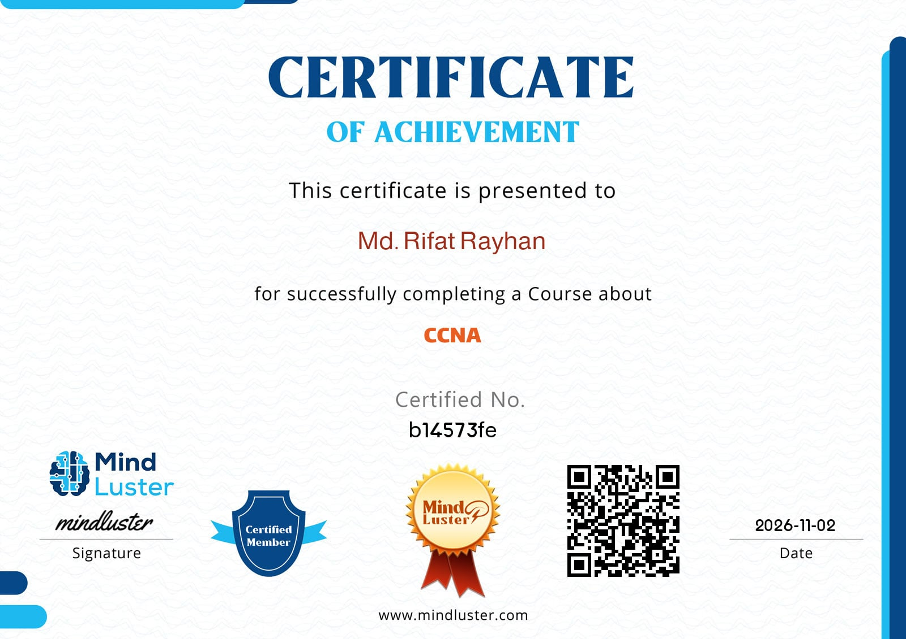

  <h1>👋 Hi, I’m Md. Rifat Rayhan</h1>
  <h3>Network Engineer | CSE Graduate (BUBT)</h3>
  

    
    
    
  

---

### 👨‍💻 About Me
Computer Science & Engineering graduate from **Bangladesh University of Business & Technology (BUBT)** focusing on **Computer Networking, Enterprise Infrastructure, and Network Operations (NOC)**. Hands-on experience in designing resilient multi-tier campus networks, troubleshooting L2/L3 network incidents, and deploying containerized network monitoring stacks.

- 🎯 **Career Focus:** Network Engineer / NOC Engineer / Systems & Infrastructure Administrator
- 📚 **Core Training Completed:** CCNA (Routing & Switching), RHCSA & RHCE (RHEL 9)
- 🌱 **Currently Exploring:** Network Automation (Python & Ansible), Cloud Networking, and Advanced Linux Server Administration
- 🤝 **Collaboration:** Open to collaborating on enterprise networking labs, NOC monitoring setups, and infrastructure automation projects.

---

### 🛠️ Technical Skills

- **Routing & Switching:** OSPFv2, IPv6 Dual-Stack, VLANs, Inter-VLAN Routing, STP / Rapid PVST+, EtherChannel (LACP/PAgP), HSRPv2, NAT/PAT
- **Network Security & Wireless:** Extended ACLs, DHCP Snooping, Dynamic ARP Inspection (DAI), Port Security, SSHv2, Cisco WLC & LWAP
- **Monitoring & Troubleshooting:** Zabbix 7.0, SNMPv2c, Wireshark, Syslog, ICMP & Packet-Level Diagnostics
- **Systems & Virtualization:** Linux (RHEL 9, Kali Linux), Docker & Docker Compose, VirtualBox, Cisco Packet Tracer, Git & GitHub

---

### 🚀 Featured Networking Projects

| Project | Key Technologies | Highlights |
| :--- | :--- | :--- |
| **[Network Monitoring & Alerting System](https://github.com/MdRifatRayhan/Zabbix-Network-Monitoring-Lab)** | `Zabbix 7.0` `Docker` `SNMPv2c` `Linux` `VirtualBox` | Deployed a containerized Zabbix 7.0 monitoring stack with a simulated SNMPv2c router (`Virtual-Router-01`), custom performance dashboards, bandwidth graphing, and automated ICMP/SNMP incident alerting & recovery. |
| **[Enterprise Multi-Tier Campus Network Infrastructure](https://github.com/MdRifatRayhan/Enterprise-Multi-Tier-Network-Infrastructure)** | `Cisco Packet Tracer` `OSPFv2` `HSRPv2` `WLC` `DAI` `IPv6` | Engineered a resilient 3-tier campus network (Core, Distribution, Access) with Layer-3 EtherChannel, Rapid PVST+, dual-stack IPv6 routing, WLC/LWAP corporate Wi-Fi, centralized DHCP/NAT/Syslog/SNMP services, and Layer-2 security hardening (DAI, DHCP Snooping, Sticky Port-Security, Extended ACLs, SSHv2). |
| **[Real-World Network Troubleshooting Lab](https://github.com/MdRifatRayhan/Real-World-Network-Troubleshooting-Lab)** | `Cisco Packet Tracer` `Wireshark` `OSPF` `VLANs` `ACLs` | Executed and documented 20 enterprise network troubleshooting scenarios covering DNS/DHCP failures, inter-VLAN routing, NAT/PAT, OSPF adjacencies, HSRP, STP, and LACP EtherChannel. |

---

### 🏆 Digital Badges & Training Certifications

#### Verified Cisco Networking Academy Badges

  
  
  
  

#### Course Completion Certificates (CCNA & Red Hat Enterprise Linux)

  
  

---

### 📊 GitHub Stats

  
  

